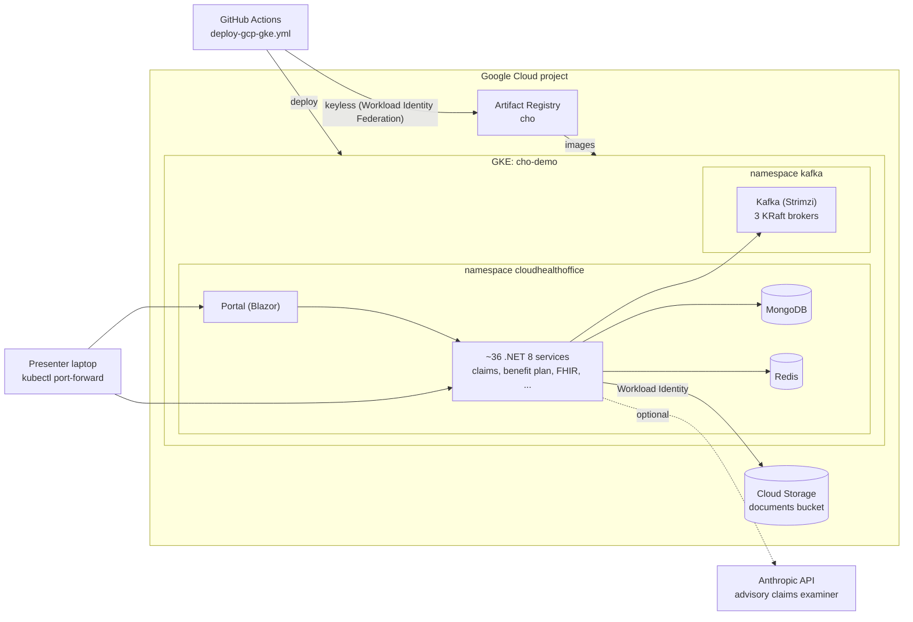

# Cloud Health Office demo on Google Cloud (GKE)

This runbook stands up Cloud Health Office on GKE (a single-node Standard cluster by default, or Autopilot), runs a 25-minute demo, and tears it down. The same services that run on Azure AKS run here without an application rewrite. Only the infrastructure, manifests rendering and secrets differ.

> **Demo-grade.** Synthetic data only. By default the cluster trusts the repository's public development signing key; with [production security](#production-security) configured it trusts only a Cloud KMS key instead. It has no public ingress; it is reached by `kubectl port-forward`, or optionally at `demo.cloudhealthoffice.com` through a Cloudflare Tunnel behind Cloudflare Access (see [GCP-PUBLIC-HOSTING-PLAN.md](GCP-PUBLIC-HOSTING-PLAN.md); never without Access). It is not a HIPAA production environment. See [What this is and isn't](#what-this-is-and-isnt).

## Architecture



| Piece | Where it is defined |
|---|---|
| Cluster, image repository, documents bucket, keyless GitHub access, budget alert | [`infrastructure/gcp/`](../../infrastructure/gcp/README.md) (Terraform) |
| Build and deploy | [`.github/workflows/deploy-gcp-gke.yml`](../../.github/workflows/deploy-gcp-gke.yml), [`scripts/deploy-gke.sh`](../../scripts/deploy-gke.sh) |
| GKE-specific manifest changes | [`deploy/gcp/render_manifests.py`](../../deploy/gcp/render_manifests.py) (the service manifests themselves are shared with AKS and local) |
| Kafka | [`deploy/gcp/kafka/kafka-cluster.yaml`](../../deploy/gcp/kafka/kafka-cluster.yaml), topics from [`infrastructure/kafka/topics.yaml`](../../infrastructure/kafka/topics.yaml) |
| Demo scripts | [`scripts/demo/gcp/`](../../scripts/demo/gcp/README.md) |

## Set up (once)

1. **Create the infrastructure.** In a dedicated Google Cloud project with billing enabled:

   ```bash
   cd infrastructure/gcp
   terraform init
   terraform apply -var="project_id=YOUR_PROJECT_ID"
   ```

   Optional: `-var="billing_account_id=XXXXXX-XXXXXX-XXXXXX"` adds a budget alert. The cluster takes about 10 minutes.

2. **Configure GitHub** (Settings → Secrets and variables → Actions) from the Terraform outputs. The table in [`infrastructure/gcp/README.md`](../../infrastructure/gcp/README.md#configure-github) maps each output to a name. Add `ANTHROPIC_API_KEY` as a secret to enable the advisory AI claims examiner.

3. **Deploy.** Every merge to `main` deploys automatically (docs-only changes are skipped). To deploy by hand: Actions → **Deploy demo to GKE** → Run workflow. The first run builds 37 images in parallel and takes roughly 20–40 minutes; later runs use the build cache. To redeploy without rebuilding, enter an existing image tag (a commit SHA). Merges that land while a deploy is running queue behind it, and only the newest one deploys.
   - **Pause automatic deploys** (for example before a live demo, since a deploy restarts pods): set the repository variable `GKE_AUTO_DEPLOY` to `false`. Delete it or set it to `true` to resume. Manual runs work either way.
   - **AI claims examiner.** On for automatic runs, and for manual runs unless you untick `ai_examiner`. When it's on, the deploy fails if the `ANTHROPIC_API_KEY` secret is missing, and after rollout the examiner makes one real call to Claude with its own settings. The deploy fails, with the API's reason, if that call doesn't succeed (revoked or mistyped key, no credit, retired model). A deploy doesn't reset the demo data; `scripts/demo/gcp/reset-demo.sh --yes` clears the demo tenant's claims activity before a fresh `run-mcc.sh` load.

4. **Connect and check.** On the presenter's laptop:

   ```bash
   gcloud container clusters get-credentials cho-demo --location us-west1-a --project YOUR_PROJECT_ID   # --location us-west1 for Autopilot
   ./scripts/demo/gcp/port-forward.sh               # leave running in its own terminal
   python3 scripts/demo/gcp/cho_demo.py smoke       # must end "All smoke checks passed."
   ```

5. **Load demo results.** Run the benchmark once before the demo so the portal has run history, then again live if time allows:

   ```bash
   GAR_REPOSITORY=<vars.GAR_REPOSITORY> IMAGE_TAG=<deployed tag> ./scripts/demo/gcp/run-mcc.sh
   ```

## Demo script (25 minutes)

Rehearse twice. Record a backup video of the claim, examiner and benchmark segments, and keep saved output of each command in case the cluster misbehaves.

| Minutes | Segment | Show | Command or URL |
|---|---|---|---|
| 0–2 | Frame | Cloud Health Office as the core and data layer under a payer's products. All data is synthetic and labeled. | — |
| 2–6 | Architecture | Service map, tenant model, events through Kafka, FHIR model, adapters and operating modes. It is running on GKE now. | This page's diagram; `kubectl get pods -n cloudhealthoffice` |
| 6–7 | How it was built | Multi-agent AI development with scoped tasks, acceptance criteria and independent audits. | — |
| 7–13 | A claim, live | A paid claim with its adjudication detail, then a pended NCCI claim with the AI examiner's advisory recommendation (disposition, confidence, rationale, citations) and its audit record. The claim status is unchanged; a human decides. | `python3 scripts/demo/gcp/cho_demo.py claims`; portal at http://localhost:8080 |
| 13–16 | Scale | Million Claim Challenge results in the Batch Adjudication page, plus a small live run. Published full-corpus figures (1,000,000 claims, 155.89 claims/sec, zero dead letters) are local Kubernetes benchmarks, not GKE production capacity. | Portal → Mass Adjudication; `run-mcc.sh` |
| 16–20 | CMS-0057-F | PAS `$submit` approve, deny and pend; adapter-status labels; the Da Vinci interoperability evidence. | `python3 scripts/demo/gcp/cho_demo.py adapter-status`; `FHIR_URL=http://localhost:5023 TENANT_ID=demo FHIR_TOKEN="$(python3 scripts/demo/gcp/cho_demo.py token)" ./scripts/demo/cms-0057-f-demo.sh`; [`docs/interop/davinci.md`](../interop/davinci.md) |
| 20–23 | Plugging into a plan's existing core | Tenant configuration, the operating-mode matrix, the core administration adapter QRE and the implementation blueprint. Shown as configuration and documents; legacy-core adapters are built per engagement. | [`docs/features/questionnaires/`](../features/questionnaires/), [`docs/implementation/`](../implementation/) |
| 23–25 | Where this goes, and the gaps | The gap list below. | — |

## Tear down

Stop all charges when the demo is over:

```bash
cd infrastructure/gcp
terraform destroy -var="project_id=YOUR_PROJECT_ID"
```

To pause between rehearsals without destroying the setup, scale the node pool to zero. Volumes are kept; Kafka and the services come back when the node does:

```bash
gcloud container clusters resize cho-demo --node-pool demo --num-nodes 0 --location us-west1-a
# resume: --num-nodes 1
```

On Autopilot, which bills for running pods rather than nodes, scale the workloads instead:

```bash
kubectl scale deployment --all -n cloudhealthoffice --replicas=0
kubectl scale statefulset --all -n cloudhealthoffice --replicas=0      # MongoDB and Postgres keep their volumes
kubectl delete -f deploy/gcp/kafka/kafka-cluster.yaml                   # Kafka holds no demo state worth keeping
```

To bring everything back, rerun the deploy workflow with the existing image tag. It recreates Kafka and restores replica counts.

**Cost.** The default single e2-standard-8 node (8 vCPU, 32 GB) runs about $7 a day including the cluster fee (Google's free tier credits one zonal cluster's management fee), plus about 165 GB of standard disk and image storage. Autopilot with the full resource profile is roughly $15 a day. Set the budget alert.

**Why one node by default.** A new billing account starts with 12 vCPU, 250 GB of SSD and 4 external IPs, and Google declines increases until the account has billing history. The default cluster, the `small` resource profile (lower CPU requests, one replica per service; limits unchanged) and standard persistent disk fit inside those limits. Once quota is raised, set `autopilot = true` (or a larger `node_machine_type` / `node_count`) and deploy with `resource_profile: default` for benchmark runs. The live MCC run in the demo is a small sample either way.

## Production security

By default the demo runs with the public development key and the portal's built-in demo sign-in, which is why it must never be reachable without Cloudflare Access. With the settings below, the same deploy runs with production security instead:

- **Hosts.** Every service is a `Staging` host. Like `Production`, it refuses development keys, the LocalDemo sign-in and the Testing overrides; unlike `Production`, it still accepts test X12 interchanges and keeps the demo screens. Synthetic-data components stay allowed (`SyntheticData:Allowed=true`), since the cluster holds synthetic data only.
- **Signing.** token-service runs and signs every token with the Cloud KMS key (HSM, ES256) as its own Google service account through Workload Identity. The private key never leaves Cloud KMS.
- **Trust.** The development issuers are gone: every service trusts only token-service's public key, under `cho-token-service` (users), `cho-token-service-svc` (services) and `cho-workload`.
- **Service identity.** Each service runs as its own Kubernetes service account and gets its service tokens from token-service with a projected token (audience `cho-token-service`). token-service's registry, generated by the renderer, maps each service account to exactly one client id.
- **Sign-in.** The portal signs people in from the Cloudflare Access header (`Cf-Access-Jwt-Assertion`), so there is one sign-in, Cloudflare's. token-service validates the Access token again (team keys, issuer, the application's AUD tag) and issues a CHO token only for an **Active user with that email in the demo tenant**, with that user's roles. Requests that do not come through Access (a port-forward) are not signed in.

### Turn it on

1. **Key and identity.** In `infrastructure/gcp`, set `enable_token_signing_kms = true` and run `terraform apply`. It creates the key ring, the HSM key, token-service's Google service account and the deployer's read access to the public key.
2. **Cloudflare Access application.** In Zero Trust → Access → Applications, the application for the demo hostname: copy its **Application Audience (AUD) Tag**, and keep the policy listing the people allowed in. Optionally brand the login page (Reusable components → Custom pages → Access login page: name, logo, colors).
3. **Repository variables** (Settings → Secrets and variables → Actions → Variables):

   | Variable | Value |
   |---|---|
   | `TOKEN_SIGNING_KEY_VERSION` | `terraform output -raw token_signing_key_version` |
   | `TOKEN_SERVICE_GOOGLE_ACCOUNT` | `terraform output -raw token_service_google_account` |
   | `KUBERNETES_SA_ISSUER` | `terraform output -raw kubernetes_service_account_issuer` |
   | `CF_ACCESS_TEAM_DOMAIN` | your team domain, e.g. `yourteam.cloudflareaccess.com` |
   | `CF_ACCESS_AUD` | the AUD tag from step 2 |
   | `DEMO_ADMIN_EMAILS` | your address (comma-separated for several): created as Active TenantAdmin users of the demo tenant |

   All five of the first settings, or none. With some but not all, the deploy fails rather than run half-configured.
4. **Deploy** (push to main, or run the workflow). The log says `security: production`.
5. **Add people.** Allow them in the Access policy, then add each as a user of the demo tenant (Settings → Users, **Add User**) with the roles they should have. Both are needed: Access decides who reaches the portal; the user record decides what they can do. Removing either ends access within five minutes.

To go back to the development-key demo, delete the five variables and deploy again.

**Known limits.** Field protection (sponsor and provider bank accounts) needs a key ring outside Development, and the only one implemented is Azure Blob Storage with Key Vault, so saving bank account fields fails in this mode until a Google Cloud key ring (Cloud Storage with Cloud KMS) is added. Invitations and self-service signup are Entra flows and are not offered to Access users. The eligibility gateway demo endpoints run only on Development hosts.

## Claims analytics: FHIR store, BigQuery and Vertex AI

Optional. fhir-service can publish every finalized claim's ExplanationOfBenefit into a Cloud Healthcare API FHIR store in the same project, which streams it to BigQuery within seconds; BigQuery ML can then call Vertex AI models over those tables ([ADR 023](../adr/023-managed-fhir-store-projection.md)).

1. In `infrastructure/gcp`, apply with `enable_managed_fhir_store = true` (and `enable_vertex_ai = true` for the Vertex AI connection).
2. Set the repository variables `MANAGED_FHIR_STORE` and `MANAGED_FHIR_STORE_SERVICE_ACCOUNT` from the outputs (and `MANAGED_FHIR_STORE_TENANT` if the tenant is not `demo`).
3. Deploy with Kafka on. Adjudicate a claim and query `cho_fhir.ExplanationOfBenefit` in BigQuery.

The walkthrough, sample SQL and the Vertex AI remote model are in [Managed FHIR store analytics](../architecture/managed-fhir-store-analytics.md).

## What this is and isn't

**It is:**
- Cloud Health Office's services running on Google Cloud with no application code changes. The same manifests drive AKS, local Kubernetes and GKE.
- Kafka, MongoDB and Redis running in the cluster, with keyless GitHub Actions deploys.
- Token authentication enforced on every API: development-signed tokens by default, or Cloud KMS-signed tokens with [production security](#production-security).
- By default, services running as `Development` hosts (claims-service, provider-service and fhir-service as `Testing` hosts). A Development or Testing host refuses to start on Kubernetes unless an override says it is deliberate. The renderer sets `CHO_ALLOW_DEV_ON_DEPLOYED_HOST=true` (and `CHO_TESTING=1`, `CHO_ALLOW_TESTING_ENVIRONMENT=true`) on every Deployment, and each pod logs a warning on startup. Development hosts return exception details in error responses. That is acceptable only because the cluster holds synthetic data and is not publicly reachable.

**It isn't:**
- **A production or HIPAA environment.** Production on Google Cloud would need:
  - a Google BAA
  - customer-managed encryption keys
  - a private cluster with Private Service Connect
  - token signing and service identity as in [production security](#production-security), with staff signing in through the plan's own identity provider (Entra today) rather than Cloudflare Access
  - Google's managed services for state: Managed Service for Apache Kafka (configuration only, no code change), Cloud Storage behind the document store interface, and Google Secret Manager or HashiCorp Vault (the Vault provider already exists) behind the secret provider interface

  Estimate: about 5–7 engineer-weeks.
- **A live connection to a legacy core.** QNXT, Facets and HealthEdge adapters are interfaces with stubs, built per engagement. Augment-mode comparison needs that adapter to supply the core's results.
- **Production capacity evidence.** Benchmarks are reproducible local runs.

## Troubleshooting

| Symptom | Check |
|---|---|
| Pod in `CreateContainerConfigError` | A secret or key it references is missing: `kubectl describe pod <pod> -n cloudhealthoffice`. Add it to `scripts/deploy-gke.sh`. |
| Service crash-loops at startup | `kubectl logs deployment/<name> -n cloudhealthoffice`. A `ChoAuth` error means its host environment or `cho-service-tokens` didn't apply. |
| Kafka not ready | `kubectl get kafka,kafkanodepool,pods -n kafka`. On Autopilot, capacity can take a few minutes to arrive. On the Standard cluster, `kubectl describe pod` showing `Insufficient cpu` or `memory` means the node is full: deploy with the `small` profile or add a node. |
| `401` from every API | The token's tenant must match the `X-Tenant-ID` header (`TENANT_ID`, default `demo`). Tokens expire after 12 hours. |
| Port-forward drops | `port-forward.sh` restarts forwards automatically; rerun it if the terminal closed. |

## Contact workflow and document scanner

The GKE build matrix must include contact-service and care-management-service:
otherwise their source manifests retain Azure registry image references and the
rollout cannot finish. The renderer routes the portal's contact client to the
in-cluster contact-service and supplies its workflow downstream URLs.

The deploy script applies `deploy/gcp/document-scanner.yaml`, a cluster-private
ClamAV INSTREAM service, and waits for readiness (up to 20 minutes on the first
signature download). Signatures persist on a standard-disk PVC. Reserve 4 GiB
for the scanner. The document service uses that scanner and refuses unscanned,
failed or infected content; existing unscanned documents are not automatically
rescanned. No public scanner endpoint or CHO service identity is created.

This provides the cloud deployment wiring. Accept it with clean-download,
harmless EICAR quarantine, scanner failure and storage persistence checks before
claiming end-to-end cloud scanner readiness.

### Appeals field encryption (optional Secret Manager integration)

Member-service case intake encrypts its summary before saving the owner record.
A deployment with `SecretProvider:Provider=None` cannot complete that intake.
The [isolated appeals-secret setup](../../infrastructure/gcp/appeals-secrets/README.md)
provisions one versioned key and a read-only identity bound only to the
`cloudhealthoffice/appeals-service` Kubernetes service account. Its Terraform
plan contains five additions and no cluster changes; obtain approval for the
new secret-access binding before applying it. Key material is initialized once
outside Terraform state and never belongs in GitHub variables or manifests.

After application support is merged, set `APPEALS_SECRETS_PROJECT` and
`APPEALS_SECRETS_SERVICE_ACCOUNT` from that module's outputs. The GKE renderer
then opts only appeals-service into Google Secret Manager and uses encryption-key
readiness. If either setting is supplied without the other, deployment is refused.
Keep the contact callback routing fix from PR #1560. After rollout, reconcile any
saved Unknown intake through contact-service before attempting a correction.

### Case documents and Finish validation (2026-10-26)

Member service case review shows the original contact's document catalog under
**Case documents**. It uses the `Call` subject and contact ID for listing,
scanning, linking, upload and download; it does not copy files or create case
links. `appeals:read` alone does not grant this section: `service:read` and the
normal document-service permissions and tenant checks still apply. The website
[Contacts & Documents guide](../../src/site/docs/contact-documents-guide.html#case-documents)
includes a screenshot of a local portal preview reading the synthetic GCP case
and its existing clean file.

The preview used case `contact-b116087c0c7bc6a834b25dadcfd5eee1` and original
contact `75bc818e-672b-4594-b2c8-2063a2753dba`. The same 141-byte clean document
was visible without copying it. Portal regression validation passed 1,322 tests,
including case switching and refusal of contact documents to an appeals-only
reader.

Live Finish acceptance is **not complete**. A separate insert-only synthetic
fixture, `synthetic-finish-20261026` / `SYNTHETIC-FINISH-20261026`, was based on
seeded MCC inputs with a distinct service date. No original claim was changed.
After staging a CO-50 line denial and upholding the MUE in the GCP portal,
**Confirm and finish** reached the real re-adjudication pipeline. The pipeline
raised a new `MEDREVIEW` pend because the synthetic billing provider had no
current OIG LEIE / SAM exclusion-screening result; no examiner resolution was
saved. The returned pend also includes a current dated MUE edit snapshot.

Do not count this as a saved-decision/totals/history success or bypass the
provider gate to obtain one. Complete normal provider verification for a
suitable synthetic fixture, refresh the claim to review its current pends and
fingerprint, then repeat Finish. Verify the saved examiner resolution, line
adjustments, recalculated totals and decision note after reloading the claim.
The fixture must not be overwritten or reset blindly after an interrupted
request; inspect persisted state first.
